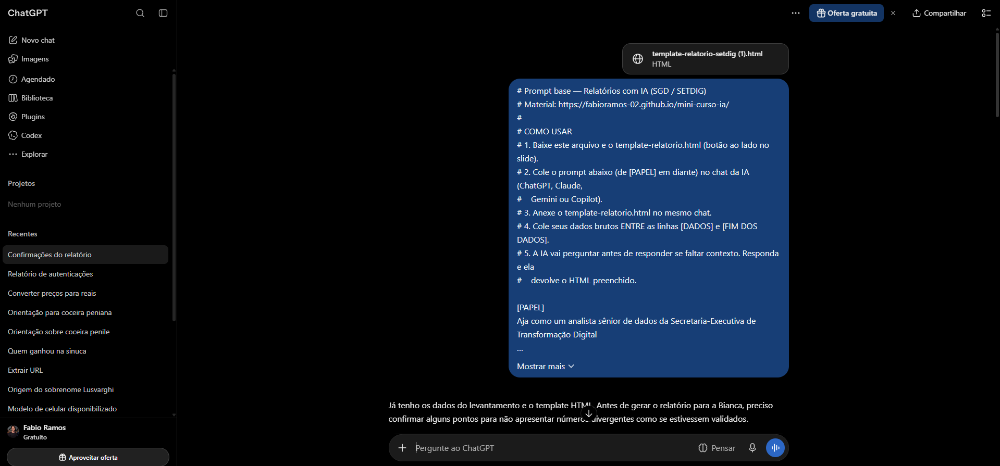
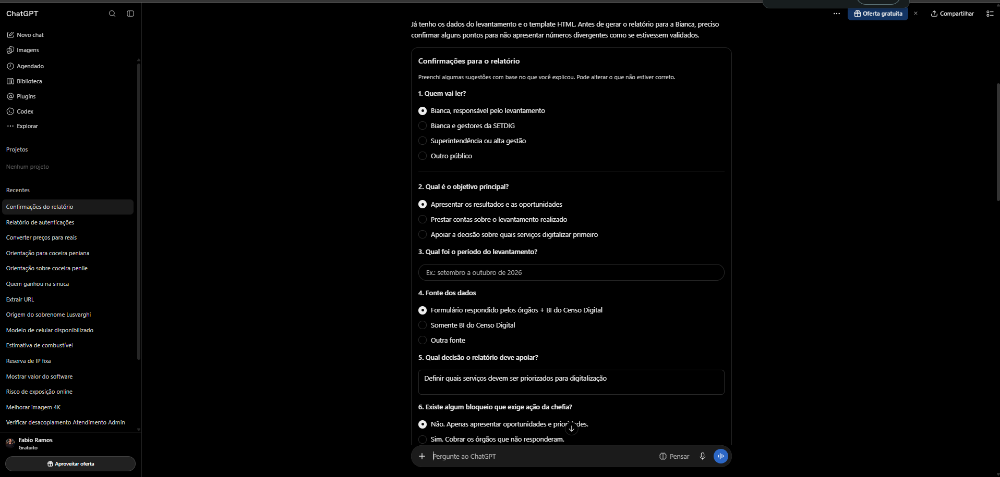
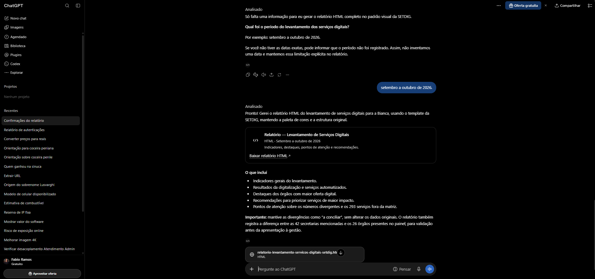

# 12. Como eu gero no ChatGPT (passo a passo real)

Esta página mostra, em três prints, como uma demanda real virou um relatório HTML
pronto. Serve como roteiro: você pode seguir os mesmos três passos.

**Demanda:** gerar um relatório do levantamento de serviços digitais do Portal
MS.GOV.BR, para a Bianca e para a gestão da SETDIG.

## Passo 1 — Colar o prompt e anexar o template

Abri uma conversa nova no ChatGPT. Colei o [prompt base](04-prompt-base.md)
inteiro e anexei o `template-relatorio.html` baixado do slide "Prompt base".

{ loading=lazy }

!!! tip "Conversa nova, sempre"
    Começar um chat novo evita que a IA puxe memória de outras conversas. O bloco
    **[ESCOPO]** do prompt reforça a mesma regra, mas conversa nova é mais seguro
    quando o dado é sensível.

## Passo 2 — A IA pergunta antes de responder

Como o prompt pede explicitamente, o ChatGPT **não gerou nada ainda**. Ele
perguntou os pontos que faltavam para o relatório ficar correto: quem vai ler,
qual o objetivo, qual o período, qual a fonte, qual a decisão a apoiar e se há
pendência que depende da chefia.

{ loading=lazy }

!!! note "Isso é bom, não é problema"
    Preferimos esse fluxo. É melhor a IA perguntar e a gente responder do que ela
    inventar e a gente ter que corrigir depois. Qualquer divergência numérica é
    tratada como **"a conciliar"**, nunca como erro — regra que também está no
    prompt.

## Passo 3 — Relatório pronto, com botão de baixar

Respondi às perguntas (incluindo o período: "setembro a outubro de 2026"). O
ChatGPT devolveu o relatório preenchido no template, com os indicadores do
levantamento, destaques, pontos de atenção e recomendações.

{ loading=lazy }

[:material-file-eye: Abrir o relatório gerado neste exemplo](exemplos/relatorio-levantamento-servicos-digitais-setdig.html){ target="_blank" .md-button }

!!! warning "Antes de enviar"
    Mesmo com o relatório pronto, passe pelo [checklist](08-checklist.md). Confira
    se cada número está no que você forneceu, se os placeholders `{{...}}` foram
    todos substituídos e se nada de dado pessoal escapou.

## O que fica desse exemplo

1. O **prompt + template** foram suficientes. Nada precisou ser combinado por fora.
2. A IA **respeitou a regra de perguntar antes**. Nenhum número foi inventado.
3. A **divergência de 35.418 cadastros** entrou como "a conciliar", não como erro.
4. O resultado abre no navegador, segue a paleta do Governo de MS e cabe no celular.
