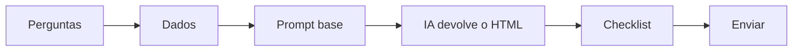

# Relatórios com IA

Mini curso da Superintendência de Governo Digital (SGD) para o time gerar relatórios com IA
**sozinho**, do pedido ao arquivo pronto.

!!! info "O que você vai conseguir fazer"
    Pedir à IA um relatório e receber de volta **um arquivo HTML pronto**, que abre no navegador,
    segue o Design System do Governo de MS e pode ser enviado para a chefia.

## Para quem é

Para quem precisa transformar dados (planilha, lista de tarefas, números de um painel) em um
relatório curto e bonito, sem saber programar.

## O caminho

1. [Por que padronizar](01-por-que.md)
2. [As 4 premissas](02-premissas.md)
3. [As perguntas antes de abrir a IA](03-perguntas.md)
4. [O prompt base](04-prompt-base.md)
5. [Os dados](05-dados.md)
6. [A estrutura no Design System](06-estrutura-ds.md)
7. [Um exemplo do começo ao fim](07-exemplo.md)
8. [O checklist antes de enviar](08-checklist.md)
9. [Próximos passos](09-proximos-passos.md)

## Apresentação

Os slides do encontro estão em [Slides](slides/index.html){ target="_blank" }.
Use as setas do teclado para avançar.

## Duração

Cerca de 1 hora: 20 minutos de conceito, 30 de prática e 10 de dúvidas.

---

*Secretaria-Executiva de Transformação Digital — SETDIG*
